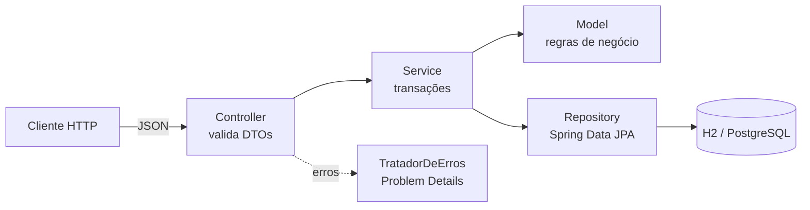

# API REST com Spring Boot — Ordens de Serviço de Manutenção

[](https://github.com/edufurlanetti/java-spring-boot-api-rest/actions/workflows/ci.yml)

API REST para **gestão da manutenção industrial**: cadastro de equipamentos e abertura de **ordens de serviço** corretivas, preventivas e preditivas, que seguem um ciclo de vida controlado. O projeto foi construído com **Java 17**, **Spring Boot 3**, **Spring Data JPA**, **Bean Validation** e documentação **OpenAPI/Swagger**, e tem testes de unidade e de integração.

> Material das disciplinas de Desenvolvimento Web e Programação Orientada a Objetos — Prof. Eduardo Furlanetti.

## Arquitetura em camadas



O ciclo de vida da ordem é uma **máquina de estados** implementada no próprio domínio (`StatusOrdem` e `OrdemServico`):

```
ABERTA ──iniciar──► EM_ANDAMENTO ──concluir──► CONCLUIDA
  └────────cancelar──────┴──────────► CANCELADA
```

## Endpoints

| Método | Rota | Descrição | Sucesso |
|---|---|---|---|
| `GET` | `/api/equipamentos` | Lista equipamentos ativos | 200 |
| `GET` | `/api/equipamentos/{id}` | Busca equipamento | 200 |
| `POST` | `/api/equipamentos` | Cadastra equipamento | 201 + `Location` |
| `PUT` | `/api/equipamentos/{id}` | Atualiza equipamento | 200 |
| `DELETE` | `/api/equipamentos/{id}` | Inativa (exclusão lógica) | 204 |
| `GET` | `/api/ordens?status=&prioridade=&page=&size=&sort=` | Lista ordens com filtros e paginação | 200 |
| `GET` | `/api/ordens/{id}` | Busca ordem | 200 |
| `POST` | `/api/ordens` | Abre ordem | 201 + `Location` |
| `PATCH` | `/api/ordens/{id}/iniciar` | Inicia atendimento | 200 |
| `PATCH` | `/api/ordens/{id}/concluir` | Conclui atendimento | 200 |
| `PATCH` | `/api/ordens/{id}/cancelar` | Cancela | 200 |
| `GET` | `/api/ordens/indicadores` | Ordens por status e média de horas por equipamento | 200 |

Os erros seguem a **RFC 9457 (Problem Details)**: `400` para validação (com a lista de campos), `404` para recurso inexistente, `409` para conflito no banco e `422` para regra de negócio violada.

```json
{
  "type": "about:blank",
  "title": "Regra de negócio violada",
  "status": 422,
  "detail": "Transição inválida: ordem ABERTA não pode passar para CONCLUIDA",
  "instance": "/api/ordens/6/concluir"
}
```

## Como executar

Requisitos: **JDK 17+** e **Maven 3.8+**.

```bash
mvn spring-boot:run
```

- Documentação interativa (Swagger UI): <http://localhost:8080/swagger-ui.html>
- Console do banco H2: <http://localhost:8080/h2-console> (JDBC URL `jdbc:h2:mem:manutencao`, usuário `sa`)
- Requisições prontas: [`http/requisicoes.http`](http/requisicoes.http)

A aplicação já sobe com equipamentos e ordens de exemplo (`src/main/resources/data.sql`).

### Com PostgreSQL

```bash
docker compose up -d
mvn spring-boot:run -Dspring-boot.run.profiles=postgres
```

### Testes

```bash
mvn test
```

- `OrdemServicoTest`: testes de unidade das regras do domínio, sem Spring.
- `ApiIntegracaoTest`: testes de integração com `MockMvc`, que sobem a aplicação inteira e verificam status HTTP, cabeçalhos e JSON.

## Conceitos praticados

Arquitetura em camadas · injeção de dependência por construtor · DTOs com `record` · Bean Validation · entidades ricas (regras no domínio) · `@Transactional` e *dirty checking* · consultas JPQL com filtros opcionais · projeções por interface · `@EntityGraph` contra o problema N+1 · paginação e ordenação · `@RestControllerAdvice` · HTTP semântico (201/204/400/404/409/422) · OpenAPI · perfis de configuração · integração contínua.

## Licença

[MIT](LICENSE)
